# Terminal Plots in Odin
This is a port of plotille, plots with unicode braille dots.

## Description
Terminal plots in Odin using Unicode Braille dots ( ⣿ ) - A port of the Python plotille library to the Odin programming language.
Plots, scatter plots, histograms and heatmaps in the terminal using braille dots and colors - with no external dependencies. Create beautiful visualizations in your terminal or CLI applications using the Odin programming language even trough SSH.

## Original Library
A port of plotille lib from Python to Odin. <br>
Github tammoippen - plotille <br>
[https://github.com/tammoippen/plotille](https://github.com/tammoippen/plotille) <br>

## Example plots images

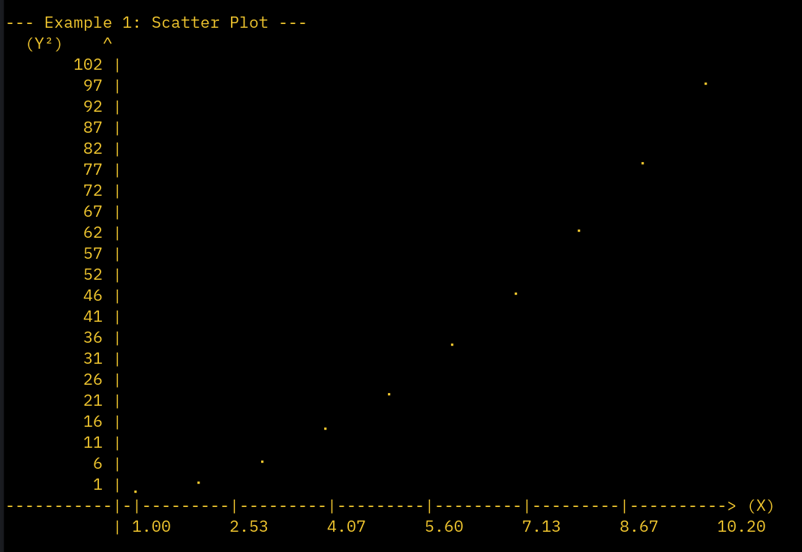

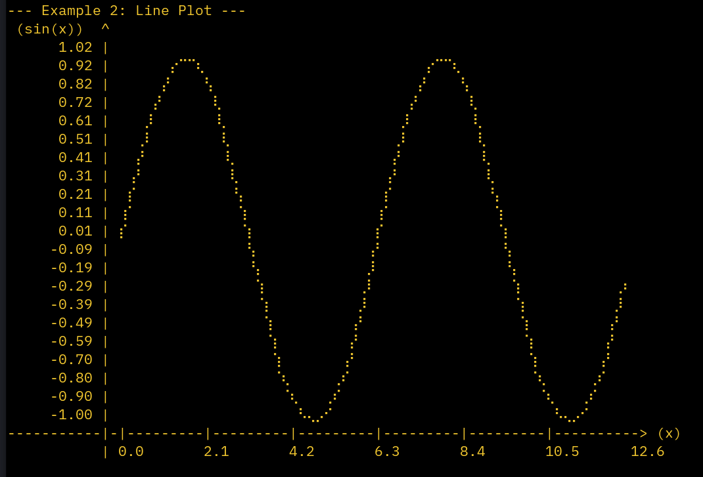

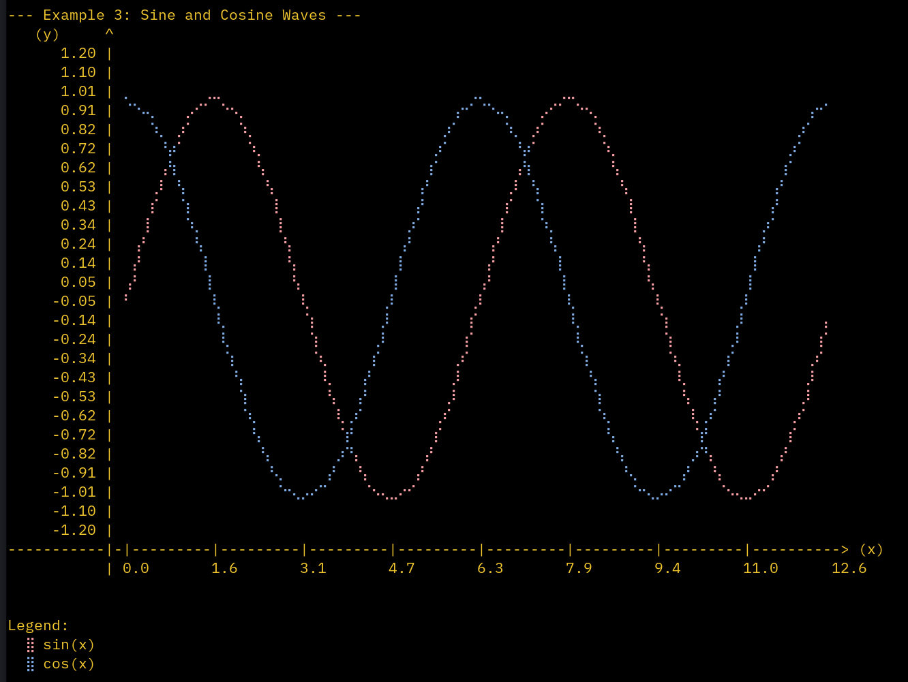

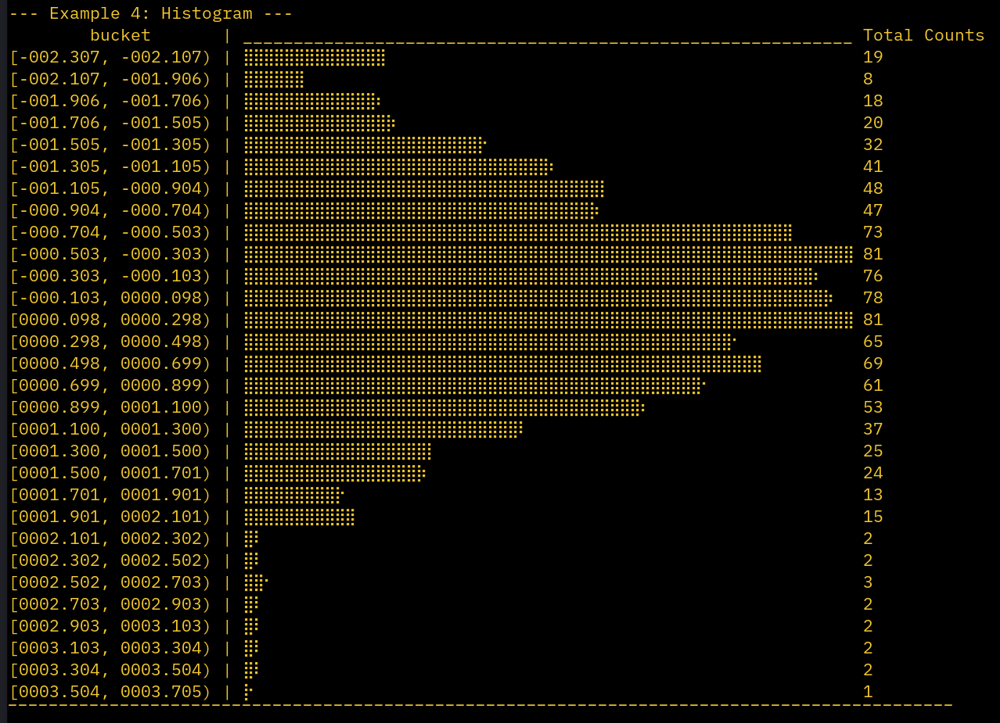

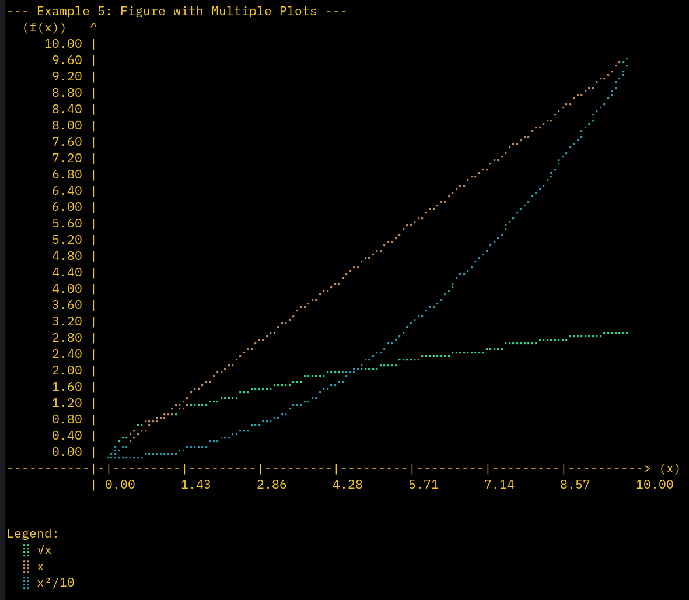

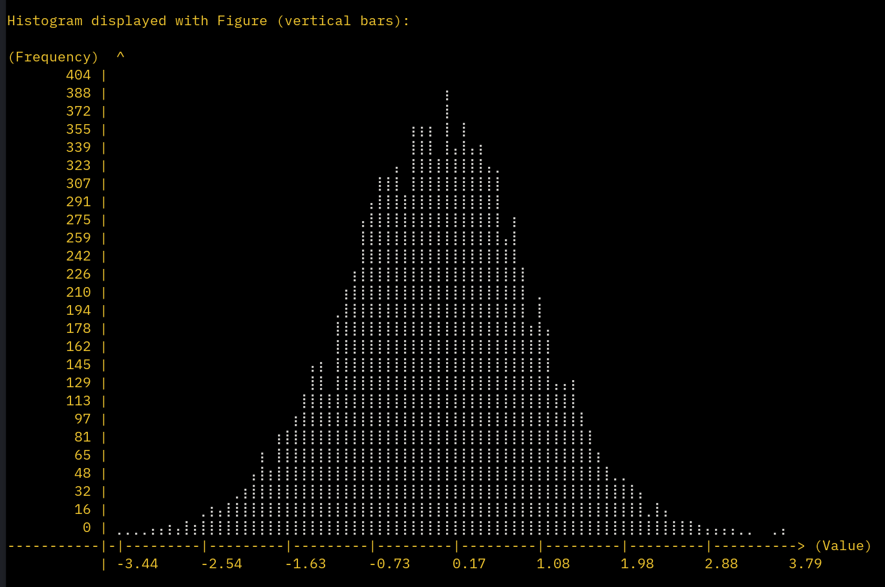

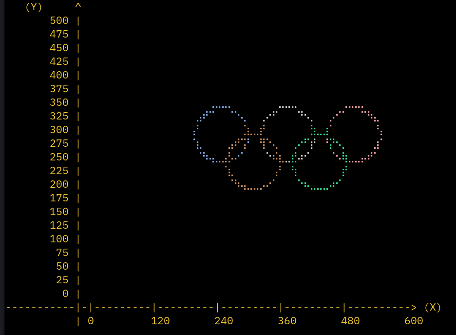

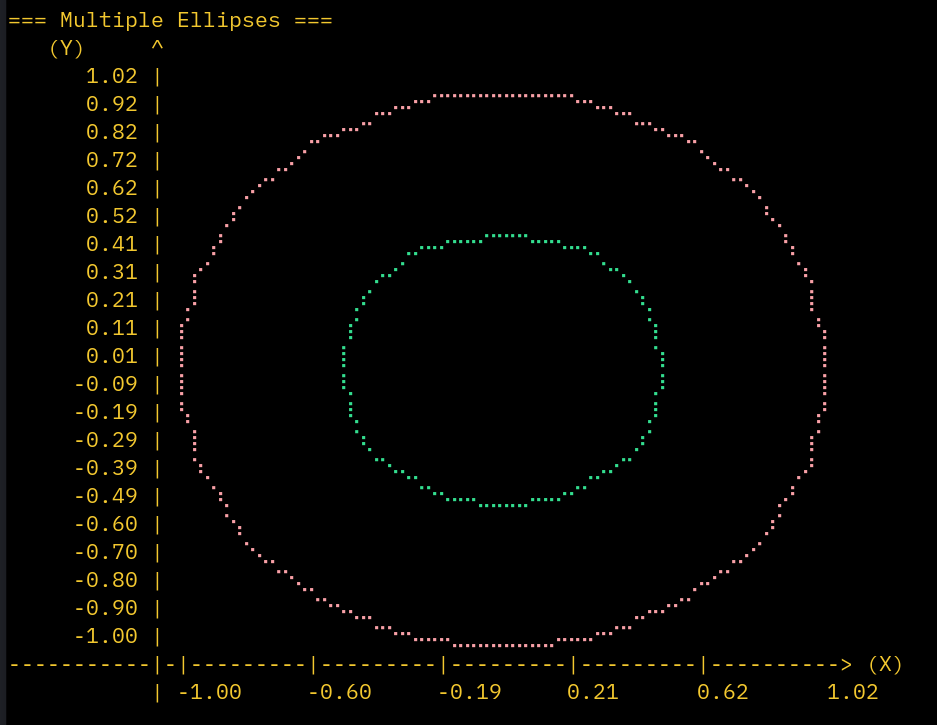

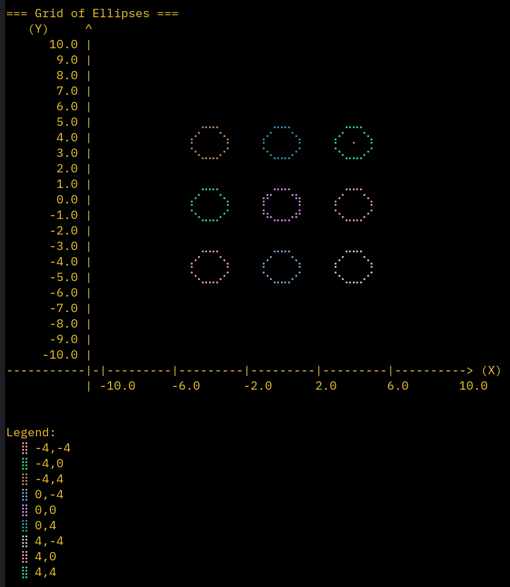

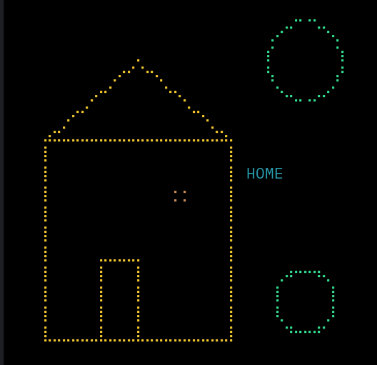

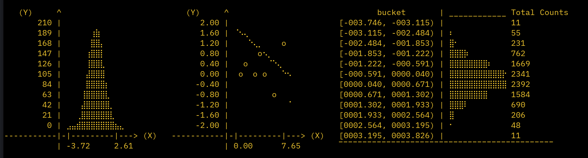

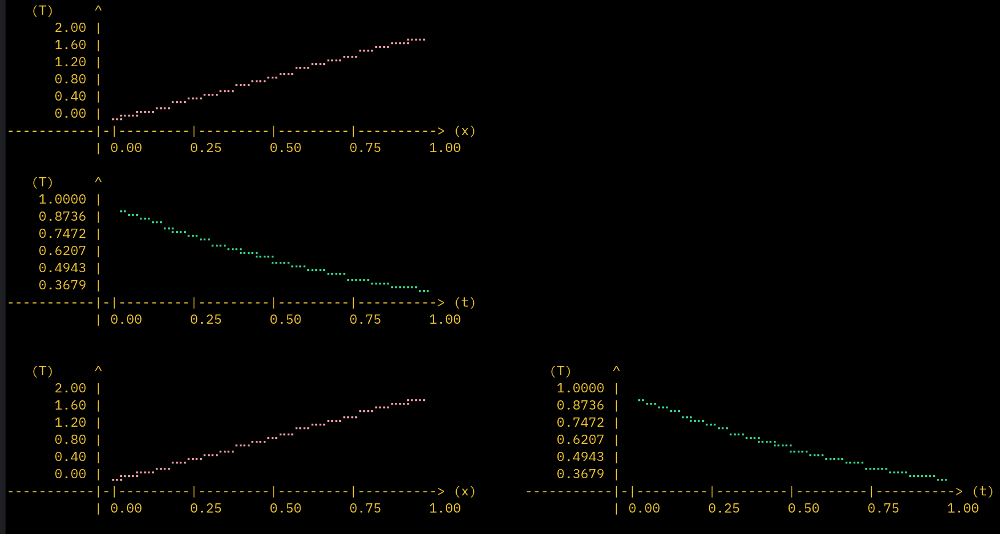

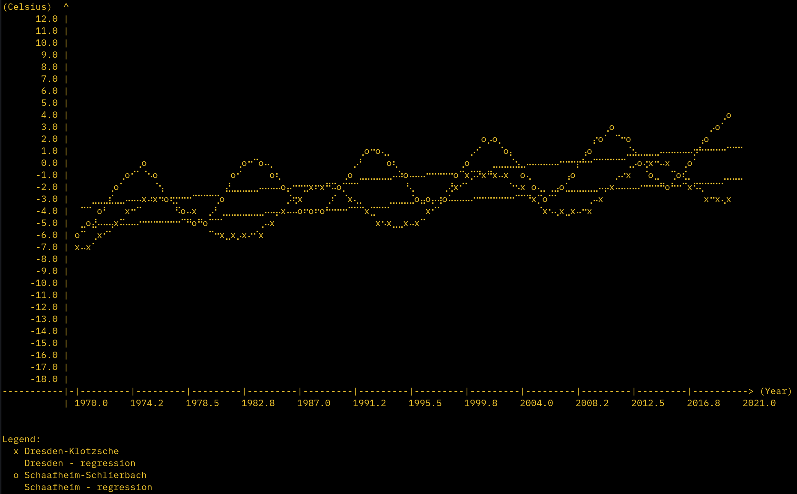


## How to compile and run

```
make
make run
```

## Scatter Plot

```odin
package main

import "core:fmt"
import plot "./terminal_plots"

main :: proc( ) {
    
    X := [ ]f64{ 1, 2, 3, 4, 5 }
    Y := [ ]f64{ 1, 4, 9, 16, 25 }
    
    result := plot.scatter( X, Y, 60, 20, "X", "Y^2" )
    fmt.println( result )
}
```

## Line Plot

```odin
import "core:fmt"
import "core:math"
import plot "./terminal_plots"

main :: proc( ) {
    
    N :: 50
    X := make( [ ]f64, N )
    Y := make( [ ]f64, N )
    defer delete( X )
    defer delete( Y )
    
    for i in 0 ..< N {
        
        x := f64( i ) / f64( N ) * 4 * math.PI
        X[ i ] = x
        Y[ i ] = math.sin( x )
    }
    
    result := plot.plot(X, Y, 60, 20, "x", "sin(x)")
    fmt.println(result)
}
```

## Figure with Multiple Plots

```odin
import "core:fmt"
import "core:math"
import plot "./terminal_plots"

main :: proc( ) {
    fig := plot.make_figure( )
    defer plot.destroy_figure( & fig )
    
    fig.width  = 80
    fig.height = 25
    plot.figure_set_x_limits( & fig, 0, 4 * math.PI )
    plot.figure_set_y_limits( & fig, -1.2, 1.2 )
    
    // Add plots with colors and labels
    plot.figure_plot( & fig, X, Y_sin, plot.Color_Name.Red, "sin( x )" )
    plot.figure_plot( & fig, X, Y_cos, plot.Color_Name.Blue, "cos( x )" )
    
    // Show with legend
    result := plot.figure_show( & fig, legend = true )
    fmt.println( result )
}
```

## Histogram

```odin
import "core:fmt"
import "core:math"
import plot "./terminal_plots"

main :: proc( ) {
    data := [ ]f64{ ... } // Your data here
    
    result := plot.hist( data, 30, 60 )
    fmt.println( result )
}
```


## Files

```bash

(base) joaocarvalho@soundofsilence:~/zed_editor/plots_terminal_in_odin> tree
.
├── examples                       # Example of usage programs
│   ├── all_examples.odin
│   ├── canvas_example.odin
│   ├── color_example.odin
│   ├── custom_ticks_example.odin
│   ├── ellipse_example.odin
│   ├── example.odin
│   ├── histograms_example.odin
│   ├── house_example.odin
│   ├── logo_example.odin
│   ├── markers_and_labels_example.odin
│   ├── network_example.odin
│   ├── olympic_rings_example.odin
│   ├── performance_example.odin
│   ├── plot_example.odin
│   ├── scatter_cats_example.odin
│   ├── scatter_example.odin
│   ├── side_by_side_example.odin
│   └── wetterdienst_example.odin
├── Makefile
├── README.md
└── terminal_plots
    ├── canvas.odin    # Drawing canvas
    ├── colors.odin    # ANSI color support
    ├── data.odin      # Ellipse and circle data generation
    ├── dots.odin      # Unicode braille dot encoding
    ├── figure.odin    # Multi-plot composition
    ├── graphs.odin    # High-level plotting functions ( plot, scatter, histogram, hist )
    └── utils.odin     # Utility functions ( histogram binning, formatting )

```

## License
MIT Open Source license 

## Have fun
Best regards, <br>
Joao Carvalho
